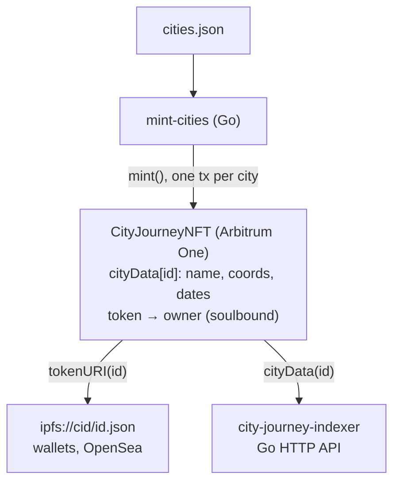

# City Journey NFT

A soulbound ERC-721 collection with one token for each city I have lived in. The city name, coordinates and dates are stored on-chain, and a small Go tool mints the tokens from a JSON file. It is deployed on Arbitrum One and all 10 tokens are minted.

**Not audited.**

## Deployment

- Network: Arbitrum One (42161)
- `CityJourneyNFT`: `0xA066b02716BEFaAb59B370224Af1c8C0bBEA1eDd`
- [Arbiscan](https://arbiscan.io/address/0xa066b02716befaab59b370224af1c8c0bbea1edd) · [Sourcify](https://repo.sourcify.dev/42161/0xA066b02716BEFaAb59B370224Af1c8C0bBEA1eDd) (exact match) · [OpenSea](https://opensea.io/collection/city-journey-nft)

The verified source is tag [`v1.0.0`](https://github.com/m15flores/city-journey-nft/tree/v1.0.0). Since then `main` only has `forge fmt` formatting and NatSpec comments; the runtime bytecode, without the metadata hash, is the same.

## Contracts

### CityJourneyNFT

[`src/CityJourneyNFT.sol`](src/CityJourneyNFT.sol) is an OpenZeppelin `ERC721` + `Ownable`. Each mint saves a `CityData` struct (name, latitude and longitude ×1e6, `fromDate` and `toDate` as Unix seconds) under the token id. Ids start at 0 and go up by one. `totalSupply` is the cap, not the minted count (that is `currentTokenId`). Metadata and images are on IPFS.

| Function | Who | What it does |
|---|---|---|
| `mint(name, lat, lon, from, to)` | owner | Mints the next id to `msg.sender` and stores its `CityData`. Reverts with `OwnableUnauthorizedAccount` for anyone else and `"Sold Out."` once the cap is reached. |
| `tokenURI(id)` | anyone | Returns `baseUri + id + ".json"`. Reverts with `ERC721NonexistentToken` if the id is not minted. |
| `cityData(id)` | anyone | Returns the stored city data (zero values for an unminted id). |
| `transferFrom`, `safeTransferFrom` | anyone | Revert with `"Soulbound: non-transferable."` for any minted token (`ERC721NonexistentToken` for an unminted id). |
| `approve`, `setApprovalForAll` | holder | Succeed, but the approval can never be used. |
| `transferOwnership`, `renounceOwnership` | owner | Inherited from `Ownable`. |

Events: `MintNFT(userAddress_, tokenId_, cityName_)`, plus the standard `Transfer`, `Approval`, `ApprovalForAll` and `OwnershipTransferred`.

### mint-cities (Go)

[`tools/mint-cities`](tools/mint-cities/main.go) reads [`cities.json`](tools/mint-cities/cities.json) and calls `mint()` once per city through `abigen` bindings. It fetches the pending nonce once and increments it locally, waits for each receipt with `bind.WaitMined`, and stops with an error if a mint reverts.

## How it works



[city-journey-indexer](https://github.com/m15flores/city-journey-indexer) is a Go backend that reads the city data straight from this contract and serves it over a small HTTP API.

## Design decisions

**Soulbound through `_update`.** In OpenZeppelin v5 every mint, transfer and burn goes through `_update`, so one check there (`from` must be `address(0)`) blocks all transfers. Overriding each transfer function separately could miss a path.

**Fixed cap, no setter.** The collection is ten cities. With no function to raise `totalSupply`, the owner cannot quietly add more later.

**City data on-chain, description off-chain.** Name, coordinates and dates stay readable even if the IPFS pin disappears, and the indexer reads them directly. The narrative text stays in the metadata JSON to avoid paying gas for long strings.

**Owner-only mint.** It is one person's story; nobody else should be able to add cities.

**Pinned pragma.** `pragma solidity 0.8.34` instead of `^0.8.x`, so the verified source always builds with the compiler that produced the deployed bytecode.

**Manual nonce and receipt wait in Go.** Letting the binding resolve the nonce for each transaction gave "nonce too low" errors, because Arbitrum confirms fast enough for consecutive lookups to race. Checking each receipt makes a reverted mint stop the run instead of being reported as minted.

## Known limitations

Contract:
- `approve` and `setApprovalForAll` still work, so a marketplace can show a listing that can never be filled.
- No ERC-5192 `locked()`, so marketplaces cannot detect that the tokens are soulbound.
- `mint` does not validate input: empty name, latitude/longitude out of range or `fromDate > toDate` are all accepted.
- The current city uses `toDate = 0` in `cities.json` to mean "still here". The contract gives it no meaning.
- `totalSupply` is the cap, not the minted count (unlike `ERC721Enumerable`).

Mint script:
- RPC URL, chain id and contract address are hardcoded.
- Not idempotent: running it again mints duplicates until the cap is reached.
- `WaitMined` has no timeout.

Process:
- Immutable contract, no upgrade path: a fix means a new deployment.
- Not audited.

## How to run

Requires Foundry and Go 1.25+.

```bash
git clone --recursive https://github.com/m15flores/city-journey-nft.git
cd city-journey-nft
forge build
forge test -vv
forge coverage --no-match-coverage "(test|script)"
```

Deploy (reads `PRIVATE_KEY` from the environment; name, symbol, cap and base URI are set in the script):

```bash
forge script script/DeployCityJourneyNFTCollection.s.sol --rpc-url <RPC_URL> --broadcast
```

Mint the cities in `cities.json` (it must run from that directory, and it targets the deployed address on Arbitrum One):

```bash
cd tools/mint-cities
PRIVATE_KEY=0x... go run .
go test ./... -cover
```

## Tests

| Suite | Tests | Covers |
|---|---|---|
| `test/CityJourneyNFT.t.sol` (Foundry) | 9 | mint and stored data, owner check, cap, transfer reverts, `Transfer` event, `tokenURI` |
| `tools/mint-cities/main_test.go` (Go) | 2 | `loadCities` with a missing file, `buildAuth` with an invalid key |

Contract coverage with `forge coverage --no-match-coverage "(test|script)"`:

| File | % Lines | % Statements | % Branches | % Funcs |
|---|---|---|---|---|
| src/CityJourneyNFT.sol | 100.00% (20/20) | 100.00% (19/19) | 100.00% (4/4) | 100.00% (5/5) |

Go coverage with `go test ./... -cover`: 1.2% of statements. Most of `main.go` needs an RPC node and the abigen bindings count toward the total.

## License

[MIT](LICENSE)
